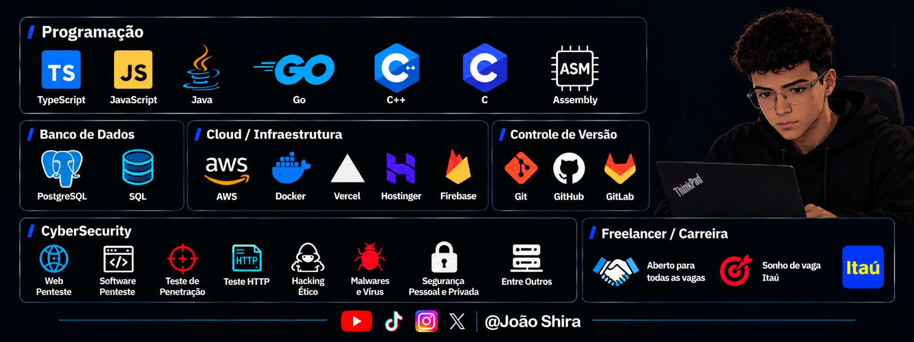

# 0xKxbyte

Programador Web Full Stack, Engenheiro de Software e Cybersecurity.
Minas Gerais, Brasil. Remoto.

Objetivo: trabalhar no Itaú.

  

---

## Sobre

Sou **Desenvolvedor Web Full Stack** e atuo há quase 2 anos na criação de sites, aplicações e projetos pessoais. Também me dedico à **Engenharia de Software**, área pela qual tenho grande interesse e na qual venho desenvolvendo meus conhecimentos há aproximadamente 2 anos.
Atualmente, estou expandindo minhas habilidades em **Cybersecurity**, uma área desafiadora que desperta minha curiosidade e vontade de aprender.
Sou apaixonado por tecnologia, programação e inovação. Meu objetivo é evoluir constantemente como profissional, realizar o sonho de trabalhar no **Itaú** e, futuramente, **fundar minha própria startup**, transformando ideias em soluções que façam a diferença.

---

## Linguagens e tecnologias

**Principais**

**Secundárias**

 

**Infraestrutura e Sistemas**

---

## Formação

| Curso | Status |
|---|---|
| PostgreSQL | Certificado |
| Web Full Stack | Conclusão 11/2026 |
| Engenharia de Software | Conclusão 12/2026 |
| Cybersecurity | Conclusão 05/2027 |

## Idiomas

| Idioma | Nível |
|---|---|
| Português | Nativo |
| Espanhol | Intermediário |
| Inglês | Básico, em evolução |

---

## Palavras-chave

`TypeScript` `JavaScript Avançado` `PostgreSQL` `Java` `Go` `Shell` `Bash` `C` `C++` `Assembly` `Git` `GitHub` `GitLab` `Docker` `Vercel` `Hostinger` `AWS` `Linux` `Red Hat Enterprise Linux` `Debian Stable` `Cybersecurity` `Engenharia de Software` 

---

## GitHub

  

---

## Contato

Aberto a oportunidades remotas.
